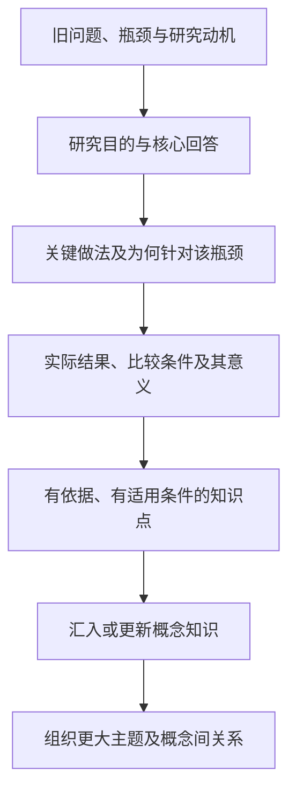

# 知识提炼：先读懂研究，再形成知识

## 最新归纳实验（2026-10-17）

用户否定现有知识索引的组织方式，要求新增独立 Wiki 归纳 SKILL，并试做失败归因、反思与记忆两个主题。旧论文提炼 SKILL 不变；归纳作者不读取分类标签、条件、未知事项及可信度附加字段。生成主题已从侧栏移除，首页入口保留。两组真实 DeepSeek 实验均未通过，未发布、未重启预算；原论文与旧页保持原样。详细结果及后续必须解决的问题见 [Wiki 归纳实验](wiki-synthesis-experiment.md)。本轮511项工程回归通过，不代表技能内容验收通过。

## 当前知识 Wiki 与来源整理（2026-10-17）

用户接受当前SKILL，并要求停止提炼剩余资料、将剩余资料移出当前库。后续明确本轮**不新增来源或订阅**，Nature/Science扩源要求已暂缓。仅操作`skill-preview`；旧库仍保留对照，活动库仍为`legacy`。

当前库保留27篇已发布解读和303条原知识点。3篇未通过提炼的来源已通过发布日志移出，原件与记录备份在`artifacts/skill-preview/backups/20261017T065912Z/skill-preview/`，清单见库内`source-removals.json`。旧30篇范围文件保留为历史，不再运行要求30篇齐全的旧`run.py`。

已生成6个主题入口、26个`knowledge_index`页面和303条独立`navigation_memberships`。每个知识点保持原命题、解释、适用范围、不确定性及来源证据定位；目录只组织阅读，不把共同分组视为跨研究结论已合并。索引使用`idx-`前缀，不能被当成已有综合概念覆盖，不使用任何受阻稿正文。综合概念及其`concept_memberships`继续单独核查；任务`j_2aa9bbcddc414a9086e4ffd5753e2858`在DeepSeek官方接口恢复后按原预算续跑。

本轮综合任务已结束：1个机制概念（6条知识点、1篇来源）通过核查并发布，25个目标保持受阻；另生成2个概念主题入口，当前合计8个主题、26个知识索引、27篇解读和1个机制概念。最终全文/向量索引覆盖89份文档、2067个块；506项回归通过。没有运行或排队任务。完整结果与逐目标阻断原因见`artifacts/skill-preview/wiki-ready-report.md`，不自动重开受阻预算。

来源整理未增加论文：已将16篇已有书目凭据的18个文件复制到当前库；从原PDF首页补齐11篇作者、机构与可见arXiv版本标识，附逐字依据、PDF/首页文本摘要与核对时间。现在27篇均有作者，24篇arXiv资料均有版本号，来源内容版本与27篇正文未变。OpenEarth-Agent的原下载地址仍未核实，PDF标注的arXiv编号可定位但不冒充在线核验；预印本、已核对正式发表记录、会议等级和带年份的IF分别记录，不推断未核实出版信息。

成果清单：`wiki-navigation-report.json`、`source-quality-final.json`、`local-bibliography-applied.json`、`localized-evidence.json`均在`artifacts/skill-preview/`。全文/向量索引使用现有SQLite与Qwen3-Embedding-8B配置，清理后的来源与新导航已增量更新；正式切换仍由用户决定。

## 阅读版式（2026-10-17）

已完成27篇已发布解读的版式整理，其中15篇原先没有正文分节，现补充按论证组织的章节标题；另12篇保留现有层级。页面独立显示大号文章标题，增强二/三级标题、粗体、段距与移动适配；已发布论文来源页提供“阅读知识解读”入口。

排版计划存于每库`presentations/<slug>.json`，绑定知识库、slug及原正文SHA256。标题仅插入原段落间，不改写任何原段落或知识点，计划过期时回退当前正文；因此不复用旧排版覆盖新内容。可读Markdown副本见`artifacts/skill-preview/formatted/`，27篇逐篇核对清单见`formatting-report.json`。原正文与独立核查记录保持原样。

当前下游任务为`j_2aa9bbcddc414a9086e4ffd5753e2858`，只读取已发布27篇/303条知识点，原提炼任务保持版本防护停止，不重开原作者预算。以任务页与`artifacts/skill-preview/synthesis-result.json`为最终状态依据；排版成功不表示概念或主题已发布。

单篇提炼与下游概念综合已支持独立持久阶段：`synthesize`任务绑定已审核论文的来源版本及知识点快照，不能读取后来新增的资料或借此重新提炼论文。原提炼任务的SKILL版本防护仍保留；SKILL发生变化不会自动重开来源作者预算。概念页仍需正文覆盖检查、原文核查和知识点核查，不能用排版成功代替内容验收。

## 当前状态（2026-10-16）

用户重新编辑了SKILL。本轮授权已改为：只使用此前实际发布的30篇论文重新生成一版知识Wiki，完成后交由用户决定；不继续剩余12篇，也不重写后来新增的12篇。新增资料任务`j_8bebf6986671464dad316875073c8eda`已取消，原42篇任务保持结束状态。

新版成果隔离在`skill-preview`库，原`candidate-v2`保留30篇旧版用于对照，正式活动库仍为`legacy`。范围和上一版正文摘要固定于每库`preview-scope.json`以及`artifacts/skill-preview/scope.json`。预览库只有这30篇的独立原件和来源记录，不继承旧知识点、提炼缓存和任务，不开启采集。

本轮先进行真实校准，发现正文过多搬运实验数字、审核将已有正确限定重复当作问题。仅调整工程的编写/核查适配提示，用户SKILL文件保持原样。校准记录与受阻缓存保留在`artifacts/skill-preview/calibration.json`。新版ReAct提案已用尽两轮修正，仍有断言表述强度问题，暂不发布；不因提示修订给它重新分配编写预算。

预览任务`j_301a9e81419d4ac7ae764a1e22efc815`继续处理固定范围中其余29篇，并综合通过核查的知识；30篇范围中ReAct的受阻状态需在最终报告单列。它此前经用户认可的版本仍保留在candidate-v2对照库。本轮不恢复原42篇或新增12篇任务。

新版SKILL只承担研究论证重建、知识提炼和独立核查，产物是`reading.md`、`knowledge.json`、`review.md`。概念对齐、主题组织及发布属于工程的独立后续流程，不要求SKILL生成页面规划。知识点保留类型、领域依赖和不确定性，不能在跨论文综合后升级证据强度。各提炼产物通过检查后保存于`readings/<source_id>/`并发布在预览库；是否达标仍需实际阅读与用户评阅。

## 架构分层（保留）

先说明一项工作为何开展、想达到什么、给出了什么回答、实际取得什么结果，再判断这些结果使我们知道了什么。概念归属和主题组织在知识点之后，写入配套结构化记录；正文不包含Wiki组织规划或编辑提示。

| 层级 | 核心职责 |
| --- | --- |
| 来源理解 | 把目的、动机、回答、结果和意义连成完整解释 |
| 知识点 | 提出结果/论证支持的可复用判断，说明为什么值得积累以及适用条件 |
| 概念页 | 围绕稳定对象或问题综合多个知识点，多来源可持续补充 |
| 主题入口 | 组织更大的学习问题、相关概念及关系，不按论文批次或采集分类分组 |

案例和操作步骤帮助解释知识，不能单凭可以独立提问就拆成页面。一个数字属于结果；知识点还要说明它支持怎样的认识。实证、机制说明和提炼者推论分开，方法存在不等于效果已经验证。

当前工程只处理真实PDF论文。资讯需要另外开发专门提取流程；本轮不从资讯、网页文章、TXT或摘要生成知识。

## 实际学习的精读规范

- [literature-workflow](/Users/Lemon/.codex/skills/literature-workflow/SKILL.md) 的完整论文笔记规则及阅读任务卡：旧问题、瓶颈、核心想法、机制、证据和认识价值须相互连接；实验数字围绕主要贡献取舍。
- [DeepPaperNote](https://github.com/917Dhj/DeepPaperNote/blob/main/skills/deeppapernote/SKILL.md)：重建整项研究的论证、主要结果及保留价值；脚本结构不能替代模型理解。
- 本地nature-reader的全文、图表与出处对齐规范：作为读取与证据辅助，不把全文块覆盖误当成知识提炼。

这些是学习来源，未照搬其他技能的全文翻译、12节笔记模板、插件配置或Obsidian保存管线。新版以用户修订的SKILL为执行规范；当前provenance.md已是证据与出处要求，不再作为旧技能学习来源清单。

## 产物与验证

[当前技能](../skills/knowledge-distillation/SKILL.md)交付连贯`reading.md`、配套`knowledge.json`及独立`review.md`，读者优先看到问题、瓶颈、设计理由、证据和认识。技能不生成概念规划或主题路由；Wiki组织由工程后续流程独立执行。旧v1字段校验脚本已移出当前技能，不能给v2内容质量背书。

ReAct和Reflexion样文用于校准提炼方向，用户要求移出正文的概念/主题规划及编辑提示已移入配套记录。两篇认可成果在重置后重新入库：[ReAct](http://127.0.0.1:8766/page/react-reasoning-and-acting?library_id=candidate-v2)、[Reflexion](http://127.0.0.1:8766/page/reflexion-learning-from-feedback?library_id=candidate-v2)。早期试读产物保留于本地`artifacts/knowledge-distillation-v2/`。

用户编写记录中的固定“证据与可信边界”模块已去除。必要条件直接写入相关知识解释，内部原文摘录、定位、来源版本和独立核查仍作为发布条件保存，不将内部核查过程变成正文或面向用户的固定写作章节。

## 实际运行与跨论文积累

`station/compiler.py`在每库`paper-workflow.json`启用时调用新的论文流程：

1. `station/paper_policy.py`核对论文类型及真实PDF原件；有PDF后的解析文字属于派生产物，不等同于TXT原文来源。
2. `station/distillation.py`读取整篇可用原文，长文分批理解后综合，产出目的、动机、核心回答、结果、知识点、断言和正文；独立请求对照原文核查，每个目标最多两轮修正。
3. `station/paper_rebuild.py`以持久发布日志写入论文解读页，同时将知识点写入SQLite的`knowledge_points`。全局ID来自来源ID与局部知识点ID，记录来源版本和变化历史。
4. `station/knowledge_synthesis.py`读取当前有效知识点，按共同问题、解释对象、机制和范围对齐概念；每个知识点均需分配或给出具体暂不纳入原因。相似度不直接决定合并。
5. 概念综合结合原文、结果及知识点，解释共性、差异和条件；核查正文覆盖与语义支持后发布，并由`topic_routes`维护较大主题入口。概念与知识点的对应保存于`concept_memberships`，读者通过论文解读、概念与主题关系浏览。

论文解读页以`page_role="paper"`标识，综合概念以`page_role="knowledge"`标识；不能仅凭页面在界面中叫“概念条目”就把论文笔记当成跨论文知识。首轮批量会产生这些层次的实际关系，当前仅针对固定30篇的新版预览检查实际效果；用户评阅前不扩展范围，也不宣称主题形成效果已达标。

缓存绑定来源内容、解析器、模型、提示、schema及技能内容；成功阶段可恢复，旧版本失效时重新处理。生产写作保持官方DeepSeek V4.1 Flash（`deepseek-flash`），embedding保持硅基流动`Qwen/Qwen3-Embedding-8B`。初期Codex试读与本轮生产模型执行分别记录，自动检查不代替人工验收。

正式发表元数据与内容提炼分开维护：`bibliography.publication_record`保存会议/期刊、载体类型、发表年份，等级与JIF各自保存指标年份、核对URL、时间和状态。没有适用或可核实值时留空，不根据论文结果生成等级；归档预印本不会因补充正式发表记录而冒充已下载正式PDF。

批量进度、受阻项、概念综合和最终索引以候选库任务记录为准；尚未完成全量验收，也没有自动切换活动库。清空旧知识前的独立备份位于`artifacts/paper-rebuild/backups/`，不依赖Git保存原件和数据库。
