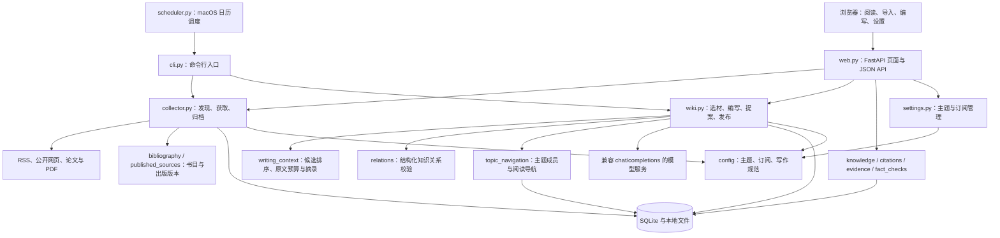
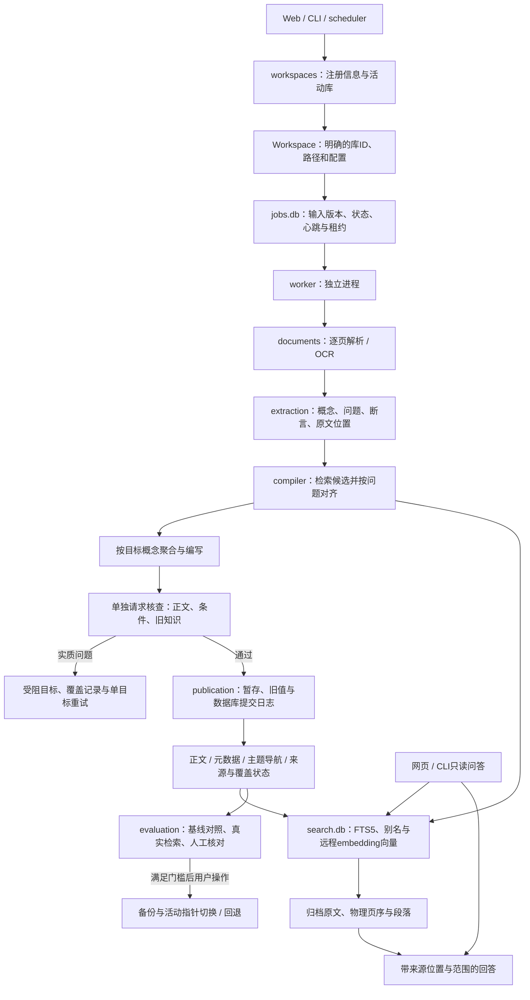
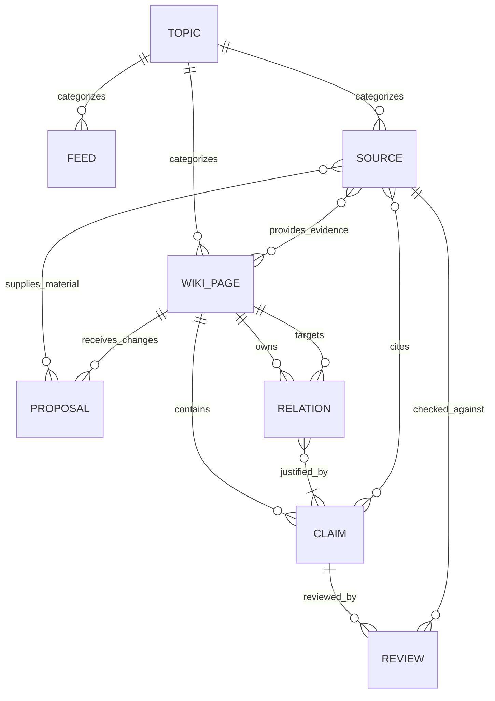
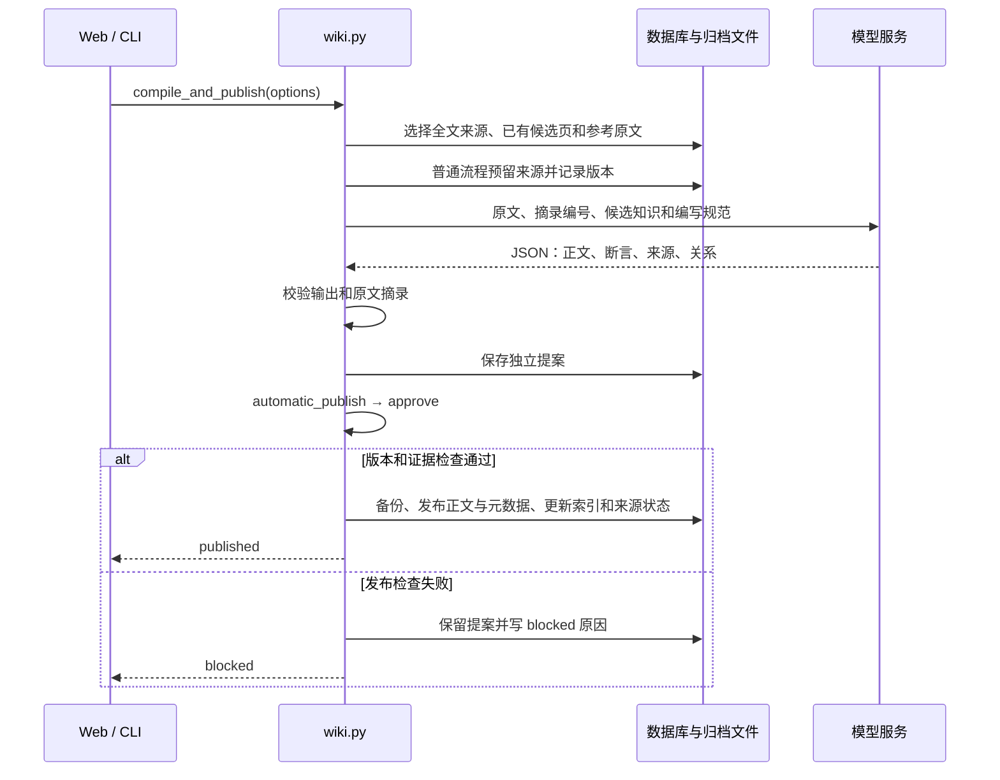
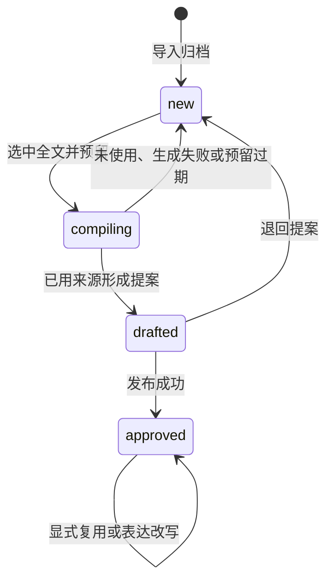

# LLM Wiki 项目说明与架构设计

> 2026-10-14 增补：已实现独立知识库、持久任务、逐页 OCR、缓存抽取、混合检索、多目标编译、独立核查、只读问答和发布恢复。本文原有流程说明对应兼容编写路径；新流程及当前迁移条件见 [V2 升级与迁移说明](v2-upgrade.md)。候选库验收通过前，正式库继续使用 legacy。

> 文档基准：2026-10-13 当前工作区代码，包含编写期间新增、最终复核时可见的主题导航实现；不代表已提交版本或部署状态。本文描述代码实现的行为；改进建议单独列出。配置默认值以代码和 `.env.example` 为准，不读取或披露本地 `.env`。历史维护记录与当前代码不一致时，以当前代码为准。

## 1. 项目定位

LLM Wiki（工程目录 `pi-intel-wiki`）是一个本机优先的资料归档与知识编写工作台。它将论文、工程文章、官方资讯、个人笔记等材料保存为可追溯的原始资料，再利用 LLM 围绕概念或知识问题编写 Wiki，保留断言、原文摘录、来源、页面联系及核查历史。

项目的核心产物是持续维护的知识页面。资料是证据输入，主题是组织方式，提案是变更载体，图谱是已保存关系的展示。它并不把每篇资料直接变成一篇摘要，也不把模型输出或“发布成功”等同于事实已经证实。

主要使用场景包括：持续订阅研究资料、围绕同一机制综合多份原文、向已有知识页补充证据、仅改写页面表达、沿来源与页面关系追溯知识。

## 2. 总体架构

### 2.1 架构形态

当前是一个 **Python 模块化单体应用，配合文件存储和 SQLite 索引**。网页、CLI 和定时采集复用同一套业务模块；worker 在独立进程中消费 SQLite 持久队列，通过库锁和任务租约协调。项目没有独立前端构建服务、外部消息代理、向量数据库或图数据库。



图中箭头表示主要调用、读取或写入方向，不是完整 Python import 图。`common.py` 为各模块提供路径、数据库、时间、标识和 JSON 存取等基础能力。

### 2.2 技术栈与选择

| 层次 | 当前实现 | 对系统的影响 |
| --- | --- | --- |
| 运行环境 | Python 3.12；uv 管理本地环境 | 使用同一个 Python 包承载业务和网页 |
| Web | FastAPI、Uvicorn | 同时提供服务端 HTML 和 JSON 操作接口 |
| 前端 | 原生 JavaScript、CSS、SVG | 无 Node 构建链；图谱交互在浏览器执行 |
| 文本展示 | Python Markdown、Bleach | Markdown 转 HTML，并清洗可展示标签与属性 |
| PDF 阅读 | 本地 PDF.js、worker、字体与 CMap | 浏览器直接阅读归档 PDF，不依赖 CDN |
| 资料处理 | feedparser、trafilatura、pypdf、Poppler、Tesseract | 订阅、网页正文、PDF逐页文字与中英OCR |
| 持久化 | SQLite WAL + JSON + Markdown + 原件文件 | 数据可直接检查，但多文件一致性需要业务层保护 |
| 模型调用 | Python urllib 请求兼容接口 | 没有独立 Agent 服务或模型 SDK 编排层 |
| 部署 | 本地进程或 Docker Compose | Web 与采集进程共享 `data/`、`config/` |

依赖范围见 [`requirements.txt`](../requirements.txt)，安装锁定版本见 [`requirements.lock.txt`](../requirements.lock.txt)。两者是不同维护入口，新增依赖时应同步检查锁文件。

### 2.3 V2 新流程的边界

2026-10-15 当前只保留“Agent 智能体”采集范围及其4个订阅，其他范围与非Agent订阅在重新归类资料后移除。`category`负责采集筛选和来源归属；`page_kind=topic`及`topic_routes`负责从结构化知识生成问题导航。两者在侧栏分别显示为“采集范围”和“知识主题”，自动编译不能新增人工分类来代替知识主题。

Web / CLI 明确选择 Workspace，并固定任务的 library_id；旧路径接口经请求上下文解析，不改进程环境变量。worker 消费库内 jobs.db，逐步调用文档解析、缓存抽取、候选检索与多目标 compiler。compiler 将验证通过的正文、元数据和主题导航交给 publication，在同一个来源数据库中保存发布日志与覆盖进度。search.db 是可重建索引；query 只读取可定位证据，不写知识正文。

候选库独立复制来源及原件，并保存旧 Wiki 基线。knowledge_coverage 记录每个来源版本的知识问题是否处理，不能由来源 stage 推导完整覆盖。evaluation 使用固定公开评测集、实际来源及独立人工记录生成切换门槛；程序测试或模型自评分不会替代人工验收。



编写与问答共享候选检索，只有编写能进入发布。向量相似度用于召回，不决定概念合并；相同模型的核查请求也不等于独立实验验证。发布的事实以 Markdown 和 JSON 为准，搜索索引可删除重建。

## 3. 工程目录与模块职责

| 路径 / 模块 | 职责 | 关键关系 |
| --- | --- | --- |
| [`station/common.py`](../station/common.py) | 数据路径、SQLite 初始化与迁移、URL 标准化、来源标识、JSON 存取 | 所有持久化模块的基础 |
| [`station/workspaces.py`](../station/workspaces.py) | 库注册、上下文、独立复制、增量同步、验收门槛、切换备份与回退 | Web、CLI、worker按相同注册信息选库 |
| [`station/jobs.py`](../station/jobs.py)、[`station/worker.py`](../station/worker.py) | 持久任务、取消/重试、租约围栏、心跳及阶段执行 | 任务绑定库和输入版本；单库一次一个编译 |
| [`station/documents.py`](../station/documents.py) | 逐页PDF/OCR、段落与字符区间、内容版本 | 为抽取、证据核查和问答提供定位 |
| [`station/extraction.py`](../station/extraction.py) | 可缓存概念/问题/断言抽取、分批覆盖记录 | 先提炼中间对象，再对齐与编写 |
| [`station/search.py`](../station/search.py)、[`station/query.py`](../station/query.py) | 统一FTS/别名/向量候选与只读回答 | 编译与问答共用候选；回答引用由程序定位 |
| [`station/compiler.py`](../station/compiler.py) | 多目标编写、正文与断言绑定、变更记录、独立核查及受限修正 | 通过后交publication；失败可按目标重试 |
| [`station/publication.py`](../station/publication.py) | 库锁、文件旧/新值、SQLite提交日志、幂等恢复 | 正文、元数据、导航和业务SQL一起提交 |
| [`station/evaluation.py`](../station/evaluation.py) | 固定评测集、旧知识映射、覆盖、候选召回与人工证据 | 生成版本绑定的切换验收报告 |
| [`station/v2web.py`](../station/v2web.py) | 库、任务、检索、问答、对照与迁移页面/API | 与原有Web共用库中间件和HTML清洗 |
| [`station/collector.py`](../station/collector.py) | RSS 发现、筛选、下载、全文提取、导入、刷新、来源分类 | 写入来源索引、原件和 raw JSON |
| [`station/bibliography.py`](../station/bibliography.py) | 书目结构与元数据处理 | 为来源展示及写作提供作者、日期、版本等信息 |
| [`station/published_sources.py`](../station/published_sources.py) | 支持的正式出版网站解析 | 为 collector 提供出版信息和全文入口 |
| [`station/published_seed.py`](../station/published_seed.py) | 已策展基础论文的补充维护入口 | 手动运行的维护工具，不是常驻服务 |
| [`station/writing_context.py`](../station/writing_context.py) | 词项相关度、长文选段、摘录编号和原文位置 | 为模型构造有预算、有来源位置的上下文 |
| [`station/wiki.py`](../station/wiki.py) | 模型请求、编写、表达改写、提案校验、发布、退回、索引更新 | 核心写入编排模块 |
| [`station/relations.py`](../station/relations.py) | 关系类型和证据约束 | 同时用于发布校验和图谱读取 |
| [`station/topic_navigation.py`](../station/topic_navigation.py) | 主题入口上下文、归属校验与导航更新计划 | 概念发布时增量合并主题成员，保留非托管正文 |
| [`station/knowledge.py`](../station/knowledge.py) | 读取知识页、分类、反向比较、生成图谱数据 | 组合 Markdown、元数据、SQLite 形成读模型 |
| [`station/citations.py`](../station/citations.py) | 引用识别、页内编号和来源列表展示 | 将内部来源标识转换成读者可理解的引用 |
| [`station/evidence.py`](../station/evidence.py) | 证据、冲突、出版状态和编辑历史的展示 | 解释已存记录及限制，不给事实打真伪分数 |
| [`station/fact_checks.py`](../station/fact_checks.py) | 逐项核查快照、版本绑定、记录保存与展示 | 将核查结论绑定到具体正文、断言和来源 |
| [`station/settings.py`](../station/settings.py) | 配置校验、版本冲突检查、锁与保存 | 管理主题和订阅两个配置文件 |
| [`station/settings_view.py`](../station/settings_view.py) | 设置页面 HTML | 由 Web 调用，数据来自 settings 快照 |
| [`station/web.py`](../station/web.py) | 页面路由、请求校验、业务调用和 HTML 组合 | UI 与业务之间的适配层 |
| [`station/cli.py`](../station/cli.py) | 导入、采集、编写、发布等命令 | 与网页调用相同业务函数 |
| [`station/scheduler.py`](../station/scheduler.py) | LaunchAgent 安装、执行锁、状态和日志 | 子进程执行ingest；依活动库使用兼容prepare或新compile |
| `station/static/` | 页面交互、主题切换、图谱、PDF 阅读器 | `app.js` 调用 JSON API；`graph.js` 消费图谱数据 |
| `config/` | 分类、订阅、写作与来源质量规范 | JSON 是运行配置；规范是否运行时使用需看具体调用 |
| `tests/` | 离线单元测试和 HTTP 工作流测试 | 用模拟模型响应验证确定性逻辑 |
| `docs/` | 架构与专题维护说明 | 记录行为背景，不能代替当前源码 |
| `artifacts/` | 本地工作产物 | 非运行时主数据，Git 忽略 |

`wiki.py` 当前同时承载多个写入职责，`web.py` 也同时承载路由和页面拼装，因此上述层次是职责划分，并不是框架强制的严格分层。

## 4. 核心实体及其关系

### 4.1 实体定义

| 实体 | 标识 / 存储 | 含义 |
| --- | --- | --- |
| 主题 Topic | `config/categories.json` 中的 `id` | 导航、资料分类、订阅归属和编写关注范围 |
| 订阅 Feed | `config/feeds.json` 中的 `id` | 发现资料的规则入口，包含启用状态、关键词和时限 |
| 来源 Source | 16 位十六进制 `id`；SQLite + raw JSON | 一份归档资料，含正文、原件位置、获取状态与书目 |
| 提案 Proposal | 新格式 `p_` + UUID；`pending/*.json` | 一次页面创建、知识更新或表达改写的候选变更 |
| 知识页 WikiPage | `slug`；`wiki/*.md` + `wiki_meta/*.json` | 可独立阅读、引用和更新的知识对象 |
| 断言 Claim | 页面元数据中的 `claims[].id` | 一项知识主张，带来源、适用范围与证据摘录 |
| 冲突 Conflict | `conflicts[]` | 不同来源的差异、范围和处理状态 |
| 关系 Relation | `relations[].id` | 从当前页指向其他页、有断言与摘录依据的联系 |
| 核查记录 Review | `claim_reviews/<slug>.json` | 对一条断言和一份来源作出的版本化核查判断 |
| 知识库 Library | 注册信息的`library_id` | 隔离来源、正文、配置、任务、索引与锁；相同来源ID不能跨库取证 |
| 解析文档 ParsedDocument | `parsed/<source-id>.json` | 物理页序、显示页码、段落、提取方法与可读性边界 |
| 抽取对象 Extraction | 来源内容/解析/模型/提示/schema的缓存身份 | 一份资料的多个概念、知识问题及断言候选 |
| 知识问题覆盖 Coverage | 来源、抽取缓存、问题ID联合键 | 问题的待处理、发布、失败或有原因的暂缓状态 |
| 后台任务 Job | `j_` + UUID；每库`jobs.db` | 固定输入版本并记录执行状态，租约过期后显式重试 |
| 发布操作 Publication | 每库`state.db`提交日志 | 将文件与业务SQL组成可恢复的提交单元 |



这是逻辑关系图，不是数据库外键图。新建提案的目标页在发布前尚不存在；提案与页面的对应由目标 `slug` 表达。大部分关系存放在 JSON 数组中，由 Python 校验。

### 4.2 容易混淆的关系

- **主题与知识页不同。** 主题是分类配置；`page_kind=topic` 是一个真实 Wiki 页面，用于问题导航。概念页通常为 `page_kind=concept`。`page_role=source_collection` 的资料清单页会被排除在编写候选与图谱知识节点之外。
- **主题入口与概念 / 研究比较是多对多。** 概念页可路由到 1～3 个主题入口；`page_role=comparison` 表示研究比较页，仍属于概念类型。主题导航按知识问题组织成员，不能与来源的 category 混用。
- **订阅与来源不同。** 订阅负责发现资料；手动导入不需要订阅。Source 的 `feed` 字段保存来源标签，并不是指向 Feed ID 的严格外键，删除订阅不会删除历史资料。
- **来源与知识页是多对多。** 多份来源可支持同一页面；同一已批准来源也可经显式复用支持其他知识问题。`approved` 不能理解成“这份原文的所有知识均已提炼”。
- **提案与来源不是一一对应。** 一个提案可组合多份原文，并只采用其中部分；新提案有独立 ID。旧来源 ID 命名的提案保留兼容读取。
- **正文链接与证据关系不同。** `[[slug|名称]]` 连接知识页；`/source/<id>` 连接原始证据。只有同属一个主题，不足以构成知识关系。
- **发布与核查不同。** 发布检查关注格式、引用、证据摘录、版本和对象保护；核查记录表达对断言与原文关系的判断。两者都不等于独立实验复现。

## 5. 数据存储与权威来源

### 5.1 为什么同时使用数据库和文件

SQLite 负责资料列表、去重入口、筛选与编写状态；文件负责保存大块原文、PDF、可编辑知识正文及结构化证据。读取一篇知识页通常需要组合多个位置，单独复制 Markdown 或数据库都不能恢复完整工作台。

| 路径 | 主要内容 | 使用者 |
| --- | --- | --- |
| `data/state.db` | `sources` 表、来源状态与 raw 路径 | 采集、选材、列表、图谱 |
| `data/raw/<id>.json` | 提取文本、书目、原件位置、获取结果 | 模型上下文、来源详情、核查 |
| `data/originals/` | PDF、HTML、Markdown、文本原件及保留版本 | 阅读器与资料追溯 |
| `data/wiki/<slug>.md` | 已发布正文与导航；`index.md` 为生成索引 | 页面阅读、关系读取 |
| `data/wiki_meta/<slug>.json` | 来源、分类、断言、冲突、关系、发布信息 | 编写保护、图谱、核查 |
| `data/pending/<proposal-id>.json` | 待发布或受阻提案、基线版本和异常信息 | 编写记录、发布、退回 |
| `data/proposal_history/` | 批准 / 退回的提案归档 | 变更追踪 |
| `data/publication_backups/` | 发布前正文和元数据的配对快照 | 发布失败恢复与维护 |
| `data/claim_reviews/` | 带版本的逐项核查历史 | 核查 API 与页面展示 |
| `data/source-catalog.json` | 公开书目快照 | 版本管理与资料目录记录，不替代原文库 |
| `data/logs/` | 调度状态、执行日志、任务锁 | 运行观测 |

以上 `data/` 为旧库默认路径。`STATION_DATA` 指定注册信息及旧库根目录，省略库ID时读取活动指针。候选库位于该根目录的`libraries/<id>/`，表中业务路径相对于各自库根目录。候选配置在库内`config/`；旧库优先使用其库内config，没有时兼容工程根config。V2新增存储及恢复步骤详见[v2-upgrade.md](v2-upgrade.md)。

### 5.2 SQLite 字段

当前主要业务表为 `sources`：

| 字段组 | 字段 | 作用 |
| --- | --- | --- |
| 身份 | `id`, `title`, `url`, `feed`, `kind` | 资料身份及类型 |
| 时间与摘要 | `published`, `captured_at`, `summary` | 来源时间、采集时间和摘要 |
| 存储与分类 | `raw_path`, `category` | 完整记录位置和主题 |
| 全文状态 | `content_status` | `full-text` / `summary-only` / `missing` |
| 编写状态 | `stage`, `claim_at` | `new` / `compiling` / `drafted` / `approved` 及预留时间 |

`common.connect()` 启用 WAL 和 15 秒忙等待，自动补齐旧表中的 `category`、`content_status`、`claim_at`，并释放超过 10 分钟的 `compiling` 预留。它不是完全无副作用的只读连接函数。

远程来源 ID 由标准化 URL / DOI / arXiv 标识的 SHA-256 前 16 位得到；本地文件则使用标题与抽取文本（无文本时使用文件字节）生成标识。arXiv 版本后缀不会直接形成另一作品。正式出版页与预印本的去重还依赖已登记书目别名，并不实现全库学术作品自动消歧。

## 6. 核心业务流程

### 6.1 资料导入与归档

1. 手动 URL、文件上传或 RSS 采集进入 `collector.py`。
2. 采集读取当前启用主题与订阅，根据标题和订阅摘要执行关键词、时限筛选；每源新增额度在筛选后应用。
3. 检查标准化标识和已登记出版别名，跳过重复资料。
4. 下载原文并归档原件。arXiv 和受支持出版网站有专门处理；网页使用正文提取，PDF 使用文字提取。
5. 保存 raw JSON 与 SQLite 索引；全文失败但有摘要时保留 `summary-only`，没有可用文字时保留缺失状态。
6. 用户可以重新获取全文、补取 PDF 或调整分类；正在编写或已有草稿的来源存在操作限制。

上传支持 PDF、Markdown、UTF-8 文本，单份上限 15 MB。扫描 PDF 保留原件，分阶段任务对文字不足页调用Poppler与Tesseract；失败页明确标为缺失。浏览器显示PDF图像不代表模型读取过图表；首版模型使用提取/OCR文字，复杂公式与图表仍需查看原件。

### 6.2 知识编写与自动发布



具体选材规则由 `prepare()` 实现：

- 默认选择启用主题下 `new + full-text` 的资料，按分类分组，每组最多 8 份；一次默认最多处理 3 个分组，每组生成一个页面提案。
- 可指定 `source_id`、`source_ids`、`topic`、`target_slug`；显式 `revisit=True` 要求提供已批准来源，复用过程不会预留或重置它们的采集状态。
- 候选页按已有中英文词项相关度排序，可跨分类，最多 8 个；指定目标优先。最靠前的 3 个候选还能提供合计最多 4 份已批准全文作为参考。
- 新来源与参考原文共享 `LLM_CONTEXT_CHARS` 预算。默认 160,000 字符，代码限制为 8,000～500,000；这是原文上下文预算，不是整个请求的 token 上限。
- 长文采用开头、章节、尾部和分布选段，保留字符区间与节选标记。字符区间指向归档提取文本，不保证对应 PDF 页码。
- 默认一次模型写作调用；JSON 解析失败可重试一次；`second_pass=True` 才请求额外表达编辑。
- 模型用 `used_source_ids` 指明本批实际使用的来源；未使用资料回到待编写。摘录编号由程序还原为原文字句，并校验出处。

`prepare()` 只生成提案；`compile_and_publish()` 在此基础上逐个自动发布。网页与 CLI 默认走后者，`draft_only` / `--draft-only` 提供开发预览。`AUTO_DRAFT` 控制采集后是否自动进入编写流程，不控制已生成提案是否需要人工批准。

### 6.3 来源状态机



`content_status` 是独立于上述状态的另一个维度：`new` 资料也可能只有摘要，因此并非所有待编写资料都能进入模型流程。发布受阻时，提案保留，普通流程已预留来源通常保持 `drafted`，供后续处理。

### 6.4 知识更新与表达改写

| 比较项 | 知识编写 / 更新 | 表达改写 |
| --- | --- | --- |
| 入口 | `prepare()`、`compile_and_publish()` | `prepare_rewrite()` 后接 `automatic_publish()` |
| 输入 | 新原文或显式复用原文，以及候选知识 | 现有页面及其归档原文 |
| 目标 | 新建概念页或更新已有页面 | 修改既有页面的语言组织 |
| 知识对象 | 在保护已有断言和关系的约束下增补 | 冻结断言、冲突、来源、分类、页面身份和关系等对象 |
| 正文引用与链接 | 校验合法来源和已存在目标 | 要求来源集合、知识链接集合保持一致 |
| 来源状态 | 普通流程参与预留、草稿和批准迁移 | 不改变采集与审批状态 |
| 版本保护 | 检查目标正文与输入来源版本等 | 还检查完整基线元数据和受保护对象 |

表达改写不承担纠正事实的职责。正文发生变化仍会使绑定旧正文的核查记录过期；“知识字段没变”不意味着旧核查可无限沿用。

### 6.5 主题导航与概念的同步维护

当前 `topic_navigation.py` 将主题归属纳入同一次编写和发布：

1. `topic_context()` 读取已有主题入口、成员标题与开头摘要，作为 `topic_candidates` 交给模型，并保存主题基线版本。
2. 概念或研究比较输出 1～3 项 `topic_routes`，包含入口 slug、该页回答的问题，以及可选导航概述；创建新入口时还需标题和概述。优先复用已有主题，不额外调用模型。
3. `validate_routes()` 禁止覆盖普通概念或资料清单，限制导航为简短普通文字。规范要求导航只描述阅读关系；程序的格式校验不能证明文字没有隐含新事实。
4. 发布时 `plan_updates()` 读取主题最新状态，增量合并成员；只有概述基线仍匹配时才采用新的 overview，避免覆盖并发更新。已有入口标题保留。
5. 自动导航位于 `<!-- wiki-topic:start -->` 与 `<!-- wiki-topic:end -->` 之间，分为“按问题阅读”和“研究与实现参考”；区块外正文与旧链接保留。
6. 概念、受影响主题的正文及元数据一起备份并进入异常补偿流程。历史及发布结果通过 `topics_updated` 记录受影响入口。表达改写不触发此导航计划；旧提案缺少路由时尝试沿已有父入口维护。

阅读侧的 `knowledge.topic_details()` 从主题正文直接链接的概念 / 比较页汇总成员和去重来源。主题页的“关联原文”是成员来源汇总，不应表述成主题自身全部拥有独立证据断言。

## 7. 发布一致性与故障处理

`approve()` 是正式写入的主要关口，即使名称保留“approve”，也可以由系统自动调用。

发布前检查目标 slug、创建 / 更新动作、页面基线版本、来源版本、所需编辑是否完成、未解决疑点、引用、断言和关系。发布用的 `page_version()` 同时计算 Markdown 与元数据文件；来源版本也考虑记录及附件内容。自动知识更新还要求新增或改变的断言具有合规原文摘录，并禁止静默丢弃已有断言支持和关系。

发布过程先保存正文和元数据的配对旧快照及受影响主题导航的旧快照，再替换目标正文、写元数据、同步主题导航、刷新索引、归档提案，最后提交相关来源状态。写入异常时尝试回滚数据库并恢复目标页、主题页和索引。成功后移除 pending 文件。

| 保护点 | 机制 | 实际边界 |
| --- | --- | --- |
| 同一页重复提案 | 提案锁与 `ensure_no_pending()` | 约束参与该协议的应用写入 |
| 来源重复预留 | SQLite 事务与 stage 检查 | 超过 10 分钟的预留会被恢复，长任务需关注该边界 |
| 设置覆盖 | 配置内容哈希版本 + 线程 / 文件锁 | 过期请求返回冲突，必须刷新 |
| 发布覆盖 | 内容版本及来源快照比较 | 外部直接编辑仍需遵守重新生成规则 |
| 多文件发布 | 发布前备份、异常恢复 | 不是文件与数据库共同的原子事务，不保证断电恢复 |
| 核查覆盖 | 页面、断言、来源三种版本；保存前再次比较 | 任一变化后旧记录标为失效，历史保留 |
| 调度重复执行 | 非阻塞文件锁 | 锁是本机文件协议，不是分布式任务租约 |

生成失败可能在 CLI 中记录警告并使本批返回较少提案，而不是直接抛出到进程顶层。调度器因此同时检查子进程退出码和约定的错误 / 警告文本。自动发布失败会返回 `blocked` 并在提案中保留原因。

## 8. 引用、事实核查与图谱

### 8.1 引用和核查链

模型生成的来源标记经程序转换成正式正文中的来源链接；`citations.py` 在展示时生成稳定的页内编号和来源短名。读者可从正文进入来源详情，再打开归档原件。

断言的 `evidence_passages` 保存与归档文本匹配的摘录。程序能检查“这些字确实出现在原文中”，不能由此证明“这段原文足以支持模型的全部解释”。

`fact_checks.snapshot()` 返回当前正文版本、断言版本、来源版本、有效记录及历史。核查结论支持 `supported`、`partial`、`contradicted`、`unverifiable`。保存时检查所选来源确实属于该断言；除无法核查外，还需位置、匹配原文的摘录与判断理由。记录区分 `human` 与 `agent`，普通阅读页当前以展示为主，API 保留写入能力。

### 8.2 图谱的真实来源

`knowledge.graph_data()` 每次从本地知识页、元数据和 SQLite 组合节点及边，输出 `nodes`、`edges`，由浏览器 `graph.js` 绘制和交互；图谱本身没有独立持久化数据库。

节点分为 `wiki:`、`source:`、`category:` 三类。边包括主题归属、已批准来源的证据边、普通知识链接，以及经过校验的结构化关系：

| 关系类型 | 含义 | 约束 |
| --- | --- | --- |
| `implementation` | 一个页面是另一机制的实现实例 | 必须关联有效断言、来源及摘录 |
| `shared_mechanism` | 两者共享具体机制 | 至少两份来源，并说明机制和范围 |
| `contrast` | 方法或条件的差异对照 | 至少两份来源，并说明差异及范围 |
| `design_inference` | 有依据的组合建议 | 至少两份来源；建议不能被展示为已验证实现 |

关系目标必须是已存在且不同于自身的知识页。已有类型化关系优先于同目标的普通链接；不创建悬空节点。关系校验失败时，图谱读取会忽略该页的类型化关系，而不是自动修复源文件。

`semantic_backlinks()` 是阅读辅助：从另一页面中提取实际链接到当前页面、并同时引用双方来源的比较段，在当前阅读页展示，最多两项。它不改写当前 Markdown，也不会因为主题相同或存在裸链接就生成比较结论。

## 9. Web、CLI 与前端的协作

### 9.1 页面与接口

| 用途 | 页面 / 读取接口 | 写入接口 |
| --- | --- | --- |
| Wiki | `/`、`/page/{slug}` | `POST /api/compile`、`POST /api/pages/{slug}/rewrite` |
| 原始资料 | `/sources`、`/source/{sid}`、`/source/{sid}/original` | `/api/import-url`、`/api/import-file`、`/api/sources/{sid}/category`、`/refresh`、`/pdf` |
| 编写记录 | `/drafts` | `POST /api/drafts/{sid}/approve`、`/reject`；这里 sid 实际可为提案 ID |
| 图谱 | `/graph`、`GET /api/graph` | 无独立图谱编辑接口 |
| 核查 | `GET /api/pages/{slug}/claim-reviews` | `POST` 同路径 |
| 设置 | `/settings`、`GET /api/settings` | `POST /api/settings/topics`、`/feeds` 及各自 ID 的 `/delete` |
| 采集观测 | `/collection` | 安装和执行日历任务由 scheduler CLI 完成 |

表中资料、记录和设置的省略路径沿用同一行前缀；具体完整路由以 `web.py` 装饰器为准。

页面主要由 Python 拼装 HTML。`app.js` 收集操作输入，以 JSON POST 调用后端，再展示结果或跳转。文件上传使用 Base64 JSON，服务端请求体上限 22 MB，解码后文件上限 15 MB。主题偏好保存在浏览器 `localStorage`。

耗时同步操作经 `run_in_threadpool()` 执行；这避免直接堵塞异步事件循环，但请求仍需等待业务完成。当前没有后台任务队列、可恢复任务 ID 或实时进度流。

### 9.2 常用命令

在工程根目录运行：

```bash
make setup
make web
make ingest
make prepare LIMIT=1 CATEGORY=ai
.venv/bin/python -m station.cli prepare --draft-only
.venv/bin/python -m station.cli prepare --source-id <source-id> --target <slug>
.venv/bin/python -m station.cli rewrite <slug>
.venv/bin/python -m station.cli rewrite <slug> --second-pass
.venv/bin/python -m station.cli drafts
.venv/bin/python -m station.cli reject <proposal-id>
make test
```

`CATEGORY=ai` 为示例，应使用本地启用主题 ID。`LIMIT` 表示最多处理多少个分类批次，不是资料条数或模型调用次数。`make prepare` 默认会发布，名称中的 prepare 不表示只预览。

## 10. 配置、调度与部署

### 10.1 配置职责

| 配置 | 作用 | 生效方式 |
| --- | --- | --- |
| `LLM_BASE_URL`、`LLM_MODEL`、`LLM_API_KEY` | 模型服务和身份 | `.env` 在模块加载时读取；修改后重启进程 |
| `LLM_JSON_MODE` | 请求 JSON 对象输出 | 需模型服务支持 |
| `LLM_CONTEXT_CHARS` | 原文上下文字符预算 | 不包含整个提示词的所有额外内容 |
| `AUTO_DRAFT` | 采集后自动编写并尝试发布 | 示例默认 false；手动编写不受其限制 |
| `MAX_PER_FEED` | 单源单轮新增上限 | 默认 12，代码限定 1～100 |
| `STATION_DATA` | 数据根目录 | 应在进程启动前设置 |
| `config/categories.json` | 主题名称、关注范围、启用状态 | 设置保存后后续读取生效 |
| `config/feeds.json` | 订阅地址、类型、分类、关键词和时限 | 下次采集使用新配置 |
| `config/wiki-writing.md` | 运行时写作规范 | 由 `writing_system()` 读取 |
| `config/source-quality.md` | 来源策展与质量规范 | 作为维护约定；不意味着所有规则都有自动评分实现 |

显式进程环境变量优先于 `.env`。编写会把选中的原文或节选、书目信息及候选 Wiki 内容发送到所配置的模型服务，数据并非始终只在本机处理。

停用主题会暂停关联订阅并排除后续导入和编写，历史知识仍可浏览；恢复主题不会自动重新开启全部订阅。有资料、知识或订阅等引用的主题不能直接删除，默认“其他”主题保留。

### 10.2 三种运行方式

1. **本地 Web：** `make web` 监听 `127.0.0.1:8765`，终端关闭即停止。启动网页不会自动安装采集计划。
2. **macOS 日历任务：** `python -m station.scheduler install` 显式安装用户 LaunchAgent，每天系统时区 08:00 触发 `scheduler run`。进程环境中的 `TZ` 不会改变 launchd 日历时区；需要开机和用户登录，关机漏跑不保证补偿。安装不会立即采集。
3. **Docker Compose：** 默认只有 Web；启用 `collect` profile 后另开 collector 容器，每 30 分钟循环采集。容器内 Web 监听 `0.0.0.0`，宿主映射限制为 `127.0.0.1:8765`。两容器共享可写数据与配置挂载。

`make collector MINUTES=1440` 是两轮工作之间等待约 24 小时，不等于每日固定 08:00。不要把轮询和日历任务当成同一种调度。树莓派部署需要 Linux 侧另设调度；当前文档不宣称实机验证完成。

## 11. 安全边界、备份和已知限制

应用面向可信本机工作空间，没有账户、角色或身份认证。Web 中间件在写请求带 Origin 时检查本地同源；无 Origin 请求不构成身份验证。部署到公网之前需要独立设计认证、授权和网络边界。

资料下载包含公网 URL、DNS 地址、重定向和连接目标检查，并禁用环境 HTTP 代理，降低 SSRF 风险；Markdown 渲染使用 Bleach 清洗，原件访问限制在归档目录。上述措施不能替代完整的多用户安全设计。

完整备份应保存 `data/`、`config/` 和妥善保管的 `.env`。SQLite 正在写入时应使用在线备份机制，或停止 Web 和采集后复制完整目录；不要只复制 `state.db` 而忽略 WAL 与同期文件。Git 当前忽略原始全文、原件、数据库、pending、发布历史、备份及日志，因此 Git 克隆不能恢复完整资料库。

当前能力边界：

- 未实现 OCR、PDF 图片视觉理解、全文向量检索或自动语义聚类。
- 一个批次生成一个主要页面提案，可同步更新多个主题导航；没有任意多概念的联合编写，也没有跨文件与数据库的原子事务。
- 关系存在和摘录匹配不能证明推理正确；同作品多个版本也不是多个独立研究。
- 图谱和反向比较由本地文件即时计算，资料规模扩大后可能需要索引和缓存。
- 模型请求最长可等待 300 秒；网络、输出格式或上下文过长都可能使本批失败。
- 文件和 SQLite 共同承载状态，手动修改文件、进程中断或磁盘错误后可能需要人工检查一致性。
- 使用 `fcntl` 文件锁，当前运行方式以 macOS / Linux 为主，不能据此承诺原生 Windows 兼容。

## 12. 测试、维护与扩展位置

### 12.1 现有验证体系

`make test` 调用 `unittest discover`。现有测试覆盖以下架构契约：

| 领域 | 代表测试文件 |
| --- | --- |
| 来源、去重、全文、书目和出版解析 | `test_core.py`、`test_sources.py`、`test_feed_filters.py`、`test_bibliography.py`、`test_published_sources.py` |
| 选材、长文上下文、模型协议 | `test_topic_selection.py`、`test_writing_context.py`、`test_llm.py` |
| 编写发布、并发保护、表达改写 | `test_workspace.py`、`test_autonomous_wiki.py`、`test_rewrite.py`、`test_rewrite_workspace.py`、`test_editorial.py` |
| 引用、关系、证据与核查 | `test_citations.py`、`test_relations.py`、`test_knowledge.py`、`test_evidence.py`、`test_fact_checks.py` |
| 主题归属与同步发布 | `test_topic_navigation.py` |
| 配置、调度、HTTP 交互 | `test_settings.py`、`test_settings_workspace.py`、`test_scheduler.py`、`test_fact_checks_workspace.py` |

模型测试使用模拟响应，不能证明真实服务可用或生成内容准确。本次为文档工作，核对了源码、接口、配置和测试定义，未调用真实模型、触发采集或运行部署验证；上表表示现有覆盖范围，不表示本次执行通过报告。

### 12.2 修改需求时从哪里入手

| 需求 | 优先修改位置 | 应一并核对 |
| --- | --- | --- |
| 新增论文网站 | `published_sources.py`、`collector.py` | 下载限制、原件身份、书目与去重 |
| 调整材料选择 | `wiki.prepare()`、`writing_context.py` | 资料预留、复用语义、预算与引用范围 |
| 改善写作方式 | `config/wiki-writing.md`、`wiki.py` | 输出契约、证据校验、旧断言保护 |
| 新增关系类型 | `relations.py`、`knowledge.py`、`static/graph.js` | 类型标签、双向语义、断言和来源要求 |
| 调整主题导航 | `topic_navigation.py`、`wiki.py`、`knowledge.py`、`web.py` | 增量成员合并、概述版本、托管区块与异常恢复 |
| 修改知识字段 | `wiki.py`、`evidence.py`、`fact_checks.py` | 改写冻结集合、版本摘要、旧数据兼容 |
| 新增设置 | `settings.py`、`settings_view.py`、`static/app.js` | 乐观锁、配置回滚、采集读取 |
| 增加后台任务 | `web.py`、`cli.py`、`scheduler.py` | 持久任务状态、重试、取消与幂等 |

后续若规模或协作需求上升，可优先考虑把提案生成与发布存储从 `wiki.py` 拆分、为长操作建立持久任务队列、增加文件与数据库一致性巡检，再评估搜索索引与认证。这些是扩展建议，当前尚未实现。

## 13. 相关文档

- [使用与启动说明](../README.md)
- [自动发布与跨来源综合](autonomous-wiki.md)
- [单遍写作说明](single-pass-writing.md)
- [知识联系维护记录](knowledge-connections.md)
- [表达改写试点](rewrite-pilot.md)
- [领域资料导入记录](domain-agent-import.md)
- [Wiki 编写规范](../config/wiki-writing.md)
- [来源质量规范](../config/source-quality.md)

阅读顺序建议：先看本文第 2～6 节理解架构和实体，再读第 7～8 节理解一致性与证据边界；实际启动和操作使用 README，具体历史决策查对应专题记录。
